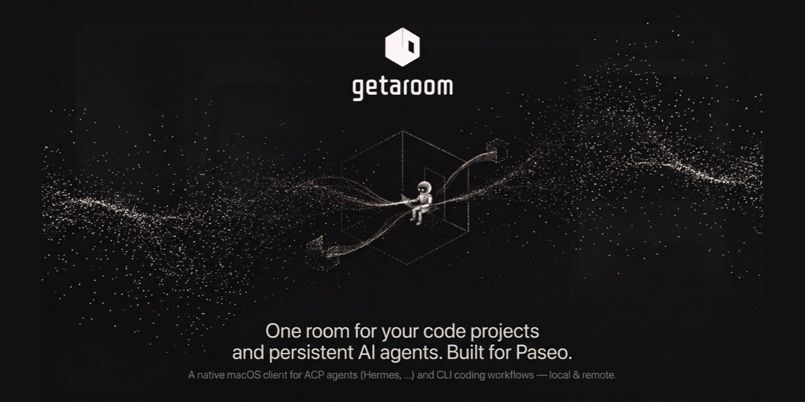

# getaroom

[🇬🇧 English](README.md) | 🇫🇷 **Français**



**Plus qu’une grille de terminaux.** Là où les lanceurs CLI gèrent des onglets locaux éphémères, **getaroom** est un client macOS natif pour le [protocole Paseo (ACP)](https://github.com/getpaseo/paseo). Il réunit deux univers dans un même espace :

- **PROJETS · développement assisté par IA :** Travaille sur ton Mac ou un hôte Paseo distant, avec l’état Git/GitHub, les diffs, commits, branches, synchronisation et pull requests directement dans la session.
- **ROOM · agents persistants :** Retrouve des coéquipiers IA vivants et animés, avec un rôle dédié et une mémoire continue au sein de leurs conversations Paseo. Ils restent disponibles au-delà d’un seul dépôt, avec tes agents Hermes sur Unraid aux côtés de tes projets locaux.

Relie plusieurs hôtes Paseo, reprends tes sessions, valide les demandes d’outils et choisis parmi les providers et modèles publiés par chaque hôte. Un hôte distant peut être joint sur ton propre réseau, y compris via Tailscale.

## Prérequis

- macOS 12 ou plus récent ; les builds actuels ciblent les Mac Apple Silicon.
- Un daemon Paseo actif pour les projets locaux, ou un hôte Paseo distant joignable pour ROOM. L’adresse locale par défaut est `ws://127.0.0.1:6767/ws`.
- [Bun](https://bun.sh/) et Rust uniquement pour compiler le code source.

getaroom est un **client**. Les fournisseurs, modèles, espaces de travail, sessions et permissions viennent de Paseo ; aucune clé de modèle séparée ni fichier `.env` n’est nécessaire.

## Installer le DMG

1. Télécharge `getaroom_*.dmg` depuis la page Releases du projet.
2. Ouvre le DMG et glisse **getaroom.app** dans **Applications**.
3. Lance l’app. Au premier démarrage, importe les hôtes Paseo détectés ou suis l’assistant en deux étapes.

Les builds sont signés en ad-hoc tant qu’aucun certificat Developer ID n’est configuré. Si Gatekeeper bloque un build dont tu as vérifié la provenance et le code source, exécute :

```sh
xattr -cr /Applications/getaroom.app
```

Au premier lancement, l’interface suit la langue du système : français sur un macOS en français, anglais autrement. Le choix peut ensuite être changé dans **Réglages → Interface & macOS → Langue**.

## Compiler localement

```sh
bun install
bun run check
bun run tauri:build
```

Le `.app` et le `.dmg` sont produits dans `src-tauri/target/release/bundle/`. En développement, le serveur passe par le script `dev` géré par Paseo.

## Données personnelles et sauvegarde

Les hôtes, tokens facultatifs, profils ROOM, références de projets et préférences UI sont conservés dans `~/Library/Application Support/paris.mauve.getaroom/`, avec des permissions de fichier restreintes. Les anciens hôtes et préférences WebView sont migrés au démarrage. Le dépôt ne contient que [`agents.example.json`](src/config/agents.example.json) et [`hosts.example.json`](src/config/hosts.example.json) ; les fichiers personnels sont ignorés par Git.

Dans **Réglages → Interface & macOS → Profil & synchronisation**, exporte ou importe `getaroom-profile.json`, choisis Fusionner ou Remplacer, ou indique un fichier JSON dans un dossier synchronisé. Les tokens sont exclus des exports par défaut. Paseo reste la source de vérité pour les répertoires de projets et les sessions ; le profil portable conserve leurs références.

## Licence

[MIT](LICENSE) © Mauve Studio.
