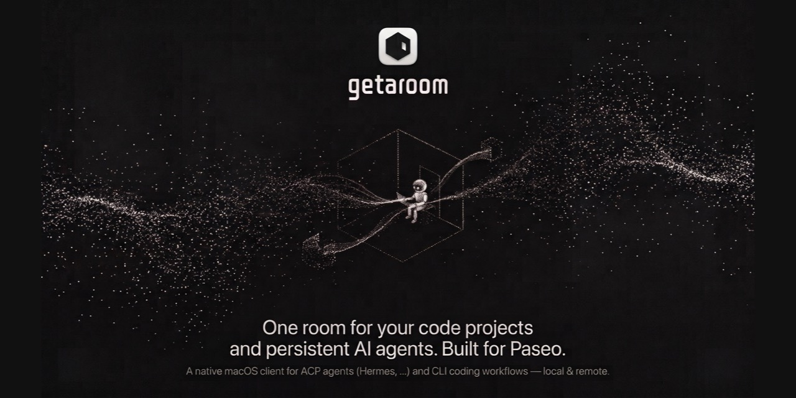
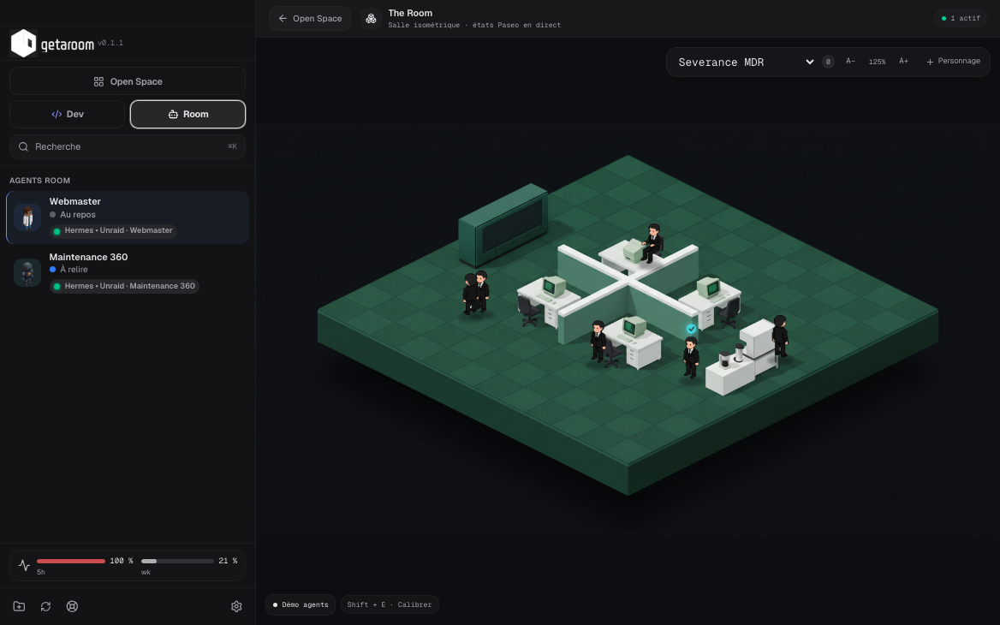
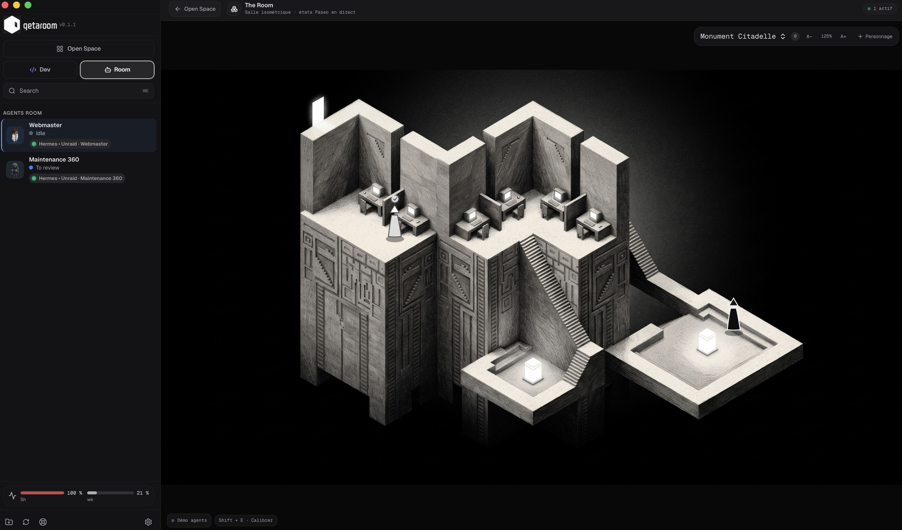

# getaroom

🇬🇧 **English** | [🇫🇷 Français](README.fr.md)




**Not just another terminal grid.** While CLI launchers manage ephemeral local tabs, **getaroom** is a native macOS client for the [Paseo protocol (ACP)](https://github.com/getpaseo/paseo). It brings two kinds of work into one space:

- **Projects · AI coding:** Work with code on your Mac or a remote Paseo host, with Git and GitHub status, file diffs, commits, branches, sync, and pull requests in the same session.
- **ROOM · persistent agents:** Living, animated AI teammates with dedicated roles and continuous memory within their Paseo conversations. They stay available beyond any single repository, with agents such as Hermes on Unraid alongside your local coding projects.

Connect multiple Paseo hosts, resume sessions, approve tool requests, and choose from the providers and models each host publishes. A remote host can be reached over your own network, including Tailscale.

## Paseo compatibility and Getaroom extensions

Getaroom preserves Paseo's client, SDK and daemon contracts for sessions, providers, approvals, Git status and diffs, local commits, terminals and provider usage. Workspace operations are sent through Paseo's SDK to the selected workspace and its exact repository path; Getaroom does not replace Paseo's project or session model.

Getaroom adds its own **ROOM**, a visual AI simulator where persistent agents move through two spaces: **Severance Office** and **Monument Office**. You can observe their activity, focus them, or pick an agent up by the collar and move it to another workstation. It also includes a unified **Open Space**. These features sit above Paseo and leave its native protocol and runtime behavior intact.

### ROOM · visual AI simulator

| Severance Office | Monument Office |
| --- | --- |
|  |  |


## Requirements

- macOS 12 or later; the current release build targets Apple Silicon.
- A running Paseo daemon for local projects or a reachable remote Paseo host for ROOM. The local default is `ws://127.0.0.1:6767/ws`.
- [Bun](https://bun.sh/) and Rust only when building from source.

getaroom is a **client**. Providers, models, workspaces, sessions and permissions come from Paseo; no separate model API key or `.env` is needed.

## Install the DMG

1. Download `getaroom_*.dmg` from the project's Releases page.
2. Open the DMG and drag **getaroom.app** to **Applications**.
3. Launch the app. On first run, import detected Paseo hosts or use the two-step setup.

Release artifacts are ad-hoc signed until a Developer ID certificate is configured. If macOS Gatekeeper blocks a build you trust, inspect its source and release provenance first, then run:

```sh
xattr -cr /Applications/getaroom.app
```

The UI follows the system language on first launch: French when macOS is set to French, English otherwise. Change it later under **Settings → Interface & macOS → Language**.

## Build locally

```sh
bun install
bun run check
bun run tauri:build
```

The `.app` and `.dmg` are produced under `src-tauri/target/release/bundle/`. Development runs through Paseo's managed `dev` workspace script.

## Personal data and backup

Hosts, optional tokens, ROOM profiles, project references and UI preferences are kept in `~/Library/Application Support/paris.mauve.getaroom/` with restricted file permissions. Existing host and WebView preferences are migrated on startup. The repository contains only [`agents.example.json`](src/config/agents.example.json) and [`hosts.example.json`](src/config/hosts.example.json); personal files are ignored by Git.

Use **Settings → Interface & macOS → Profile & sync** to export or import `getaroom-profile.json`, choose Merge or Replace, or point to a JSON file in a synchronized folder. Access tokens are excluded from exports by default. Paseo remains the authority for actual project directories and sessions; a portable profile keeps their references.

## License

[MIT](LICENSE) © Mauve Studio.
